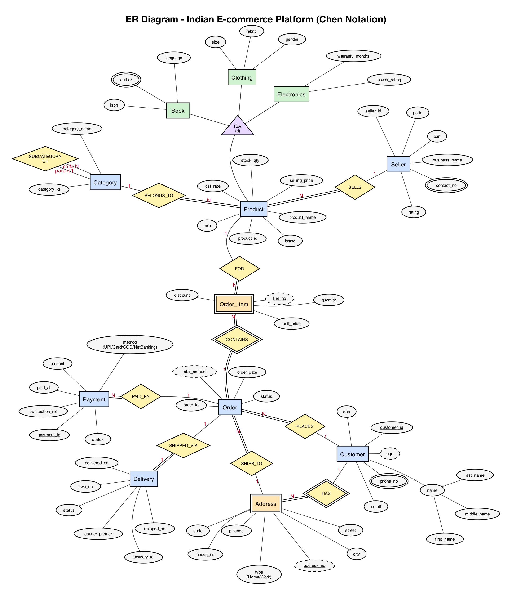
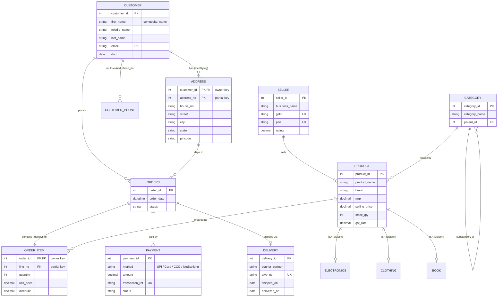

# Experiment 1 - ER Diagram for an Indian E-commerce Platform

## Aim

Design an Entity-Relationship (ER) diagram for an Indian e-commerce platform with the entities **Customer, Product, Order, OrderItem, Seller, Category, Payment, Delivery and Address**. Show the primary keys, composite and multi-valued attributes, weak entities, the specialization of Product, and participation constraints.

## Software / Tools Used

| Tool | Purpose |
|------|---------|
| Graphviz (`dot`, neato layout) | Drawing the ER diagram from a text description (`er_diagram.dot`) |
| VS Code | Editing the diagram source |
| GitHub (Mermaid) | Second view of the same model in crow's-foot notation |

## Theory

**ER model.** The Entity-Relationship model (P. P. Chen, 1976) describes a database at the conceptual level as *entities*, their *attributes*, and the *relationships* between them.

| Concept | Meaning | Chen notation |
|---|---|---|
| Strong entity | Has its own primary key | Rectangle |
| Weak entity | Cannot be identified by its own attributes; depends on an *owner* entity | Double rectangle |
| Identifying relationship | Links a weak entity to its owner | Double diamond |
| Key attribute | Uniquely identifies an entity | Underlined ellipse |
| Partial key (discriminator) | Identifies a weak entity *within* one owner | Dashed ellipse / dashed underline |
| Composite attribute | Can be divided into sub-parts | Ellipse connected to sub-ellipses |
| Multi-valued attribute | Can hold many values for one entity | Double ellipse |
| Derived attribute | Computed from other attributes | Dashed ellipse |
| Total participation | Every entity must take part in the relationship | Double line |
| Partial participation | Taking part is optional | Single line |
| Cardinality ratio | 1:1, 1:N, M:N | Labels on the edges |
| Specialization / ISA | Sub-classes of a super-class entity | Triangle; `d` = disjoint, `o` = overlapping |

## ER Diagram

> The diagram source is [er_diagram.dot](er_diagram.dot), and a scalable version is in [er_diagram.svg](er_diagram.svg).
> To regenerate it: `dot -Kneato -Tpng -Gdpi=130 er_diagram.dot -o er_diagram.png`

### Same model in crow's-foot notation (rendered by GitHub)

## Design Explanation

### 1. Entities and primary keys

| Entity | Type | Primary key |
|---|---|---|
| Customer | Strong | `customer_id` |
| Seller | Strong | `seller_id` |
| Category | Strong | `category_id` |
| Product | Strong (super-class) | `product_id` |
| Order | Strong | `order_id` |
| Payment | Strong | `payment_id` |
| Delivery | Strong | `delivery_id` |
| **Address** | **Weak** (owner: Customer) | `{customer_id, address_no}`; `address_no` is the partial key |
| **Order_Item** | **Weak** (owner: Order) | `{order_id, line_no}`; `line_no` is the partial key |
| Electronics / Clothing / Book | Sub-classes of Product | `product_id` (inherited) |

### 2. Special attributes

| Kind | Attribute(s) | Why |
|---|---|---|
| Composite | `Customer.name` -> first_name, middle_name, last_name | Indian names often have an optional middle name |
| Multi-valued | `Customer.phone_no`, `Seller.contact_no`, `Book.author` | A customer can have several mobile numbers; a book can have several authors |
| Derived | `Customer.age` (from dob), `Order.total_amount` (from order items) | Computed, not stored, to avoid inconsistency |
| Unique (candidate keys) | `Customer.email`, `Seller.gstin`, `Seller.pan`, `Payment.transaction_ref`, `Delivery.awb_no` | Business identifiers |

### 3. Weak entities

* **Address** - "address #1 of customer 17" only makes sense together with the customer. If the customer is deleted, their addresses go too. It is identified through the **HAS** identifying relationship.
* **Order_Item** - "line 2 of order 1005" depends on the order. It is identified through **CONTAINS**.

### 4. Specialization of Product

`Product` is specialized into **Electronics** (warranty_months, power_rating), **Clothing** (size, fabric, gender) and **Book** (isbn, author, language).

* **Disjoint (d):** a product belongs to at most one sub-class.
* **Partial:** some products (e.g. groceries) belong to no sub-class.

### 5. Relationships, cardinality and participation

| Relationship | Entities | Cardinality | Participation |
|---|---|---|---|
| HAS *(identifying)* | Customer - Address | 1 : N | Address **total**, Customer partial |
| PLACES | Customer - Order | 1 : N | Order **total** (every order has a customer), Customer partial |
| SHIPS_TO | Order - Address | N : 1 | Order **total** |
| CONTAINS *(identifying)* | Order - Order_Item | 1 : N | **Total on both sides** (an order has at least one item) |
| FOR | Order_Item - Product | N : 1 | Order_Item **total** |
| SELLS | Seller - Product | 1 : N | Product **total** (every product has a seller) |
| BELONGS_TO | Product - Category | N : 1 | Product **total** |
| SUBCATEGORY_OF *(recursive)* | Category - Category | 1 : N | Partial |
| PAID_BY | Order - Payment | 1 : N (retries, refunds) | Payment **total** |
| SHIPPED_VIA | Order - Delivery | 1 : 1 | Delivery **total**, Order partial (cancelled orders are never shipped) |

## Procedure

1. Listed the requirements of an Indian e-commerce site: customers with several addresses and phone numbers, GST-registered sellers, a category tree, UPI/COD payments, and courier deliveries.
2. Identified the entities and chose a primary key for each one.
3. Classified the attributes as simple, composite, multi-valued or derived.
4. Identified the weak entities (Address, Order_Item) and their partial keys.
5. Identified the relationships and decided the cardinality and participation of each.
6. Modelled the Product sub-classes with a disjoint, partial ISA hierarchy.
7. Wrote the diagram in Graphviz DOT language and rendered it to PNG and SVG.

## Files

| File | Description |
|---|---|
| [er_diagram.png](er_diagram.png) | ER diagram (image) |
| [er_diagram.svg](er_diagram.svg) | ER diagram (vector) |
| [er_diagram.dot](er_diagram.dot) | Source code of the diagram (Graphviz) |

## Result

The ER diagram for the e-commerce platform was made. It has the 9 given entities, 2 weak entities (Address and Order_Item), composite, multi-valued and derived attributes, ISA specialization of Product, and cardinality and participation for every relationship.

## Conclusion

Making the ER diagram first helped me understand the data and the rules before writing any table. The weak entities, multi-valued attributes and participation constraints shown here decide the extra tables, keys and NOT NULL constraints in the next experiment.
