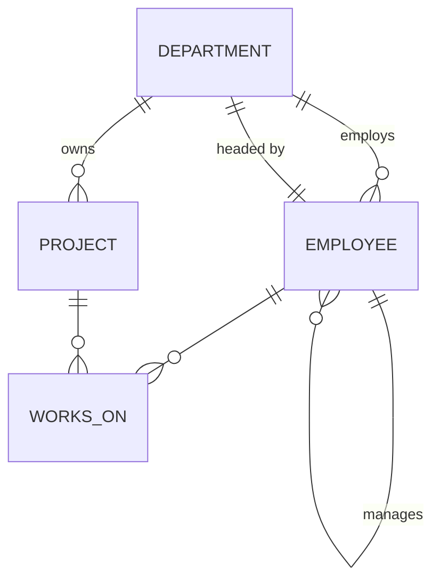

# Experiment 3 - Employee-Department-Project Schema and Basic SQL Queries

| Name | UID No | Course | Subject | Submitted To |
|---|---|---|---|---|
| Aditya Sharma | 25LBCS3150 | B.Tech CSE (AI/ML-2) | RDBMS (25CSH-210) | Mr. Amit Kumar Sir |

## Aim

Create an Employee-Department-Project schema and insert at least 30 employees across 5 departments and 8 projects. Write SQL queries that demonstrate **selection, projection, aggregate functions, GROUP BY, HAVING, CASE expressions and ORDER BY**.

## Software / Tools Used

MySQL Server 8.0+, MySQL command-line client, VS Code

## Theory

| Concept | Relational algebra | SQL |
|---|---|---|
| **Selection** - choose rows | σ<sub>condition</sub>(R) | `WHERE` with `=, <>, >, BETWEEN, IN, LIKE, AND, OR, NOT` |
| **Projection** - choose columns | π<sub>columns</sub>(R) | the column list after `SELECT`; `DISTINCT` removes duplicates |
| **Aggregate functions** | 𝒢 | `COUNT, SUM, AVG, MIN, MAX` - return one value for a set of rows |
| **GROUP BY** | <sub>grouping</sub>𝒢<sub>agg</sub>(R) | forms groups; aggregates are computed per group |
| **HAVING** | σ after 𝒢 | filters *groups* (`WHERE` filters *rows* before grouping) |
| **CASE** | - | conditional (if-then-else) expression inside a query |
| **ORDER BY** | τ | sorts the result, `ASC` (default) / `DESC`, several keys allowed |

**Logical order of evaluation:** `FROM -> WHERE -> GROUP BY -> HAVING -> SELECT -> DISTINCT -> ORDER BY -> LIMIT`

## Schema

```text
department (dept_id PK, dept_name UQ, location, mgr_emp_id FK->employee)
employee   (emp_id PK, first_name, last_name, gender, dob, hire_date, job_title,
            salary, city, dept_id FK->department, manager_id FK->employee)   -- self-reference
project    (project_id PK, project_name UQ, dept_id FK->department, budget,
            start_date, end_date, status)
works_on   (emp_id PK/FK->employee, project_id PK/FK->project, role, hours_per_week)   -- M:N
```



**Data:** 5 departments (Engineering - Bengaluru, Sales - Mumbai, Marketing - Delhi, Finance - Pune, HR - Hyderabad), **32 employees** in a 4-level reporting hierarchy, **8 projects** and 39 project assignments. Project 108 is "Planned" and has no members yet.

> `company_db` is reused by **Experiments 4, 5 and 6**. Re-run this script to reset the data.

## Procedure

1. Created `company_db` with the four tables, their primary and foreign keys, and CHECK constraints.
2. Inserted departments, then employees (manager rows before their reports), then set the department heads and added the `fk_dept_mgr` foreign key (the circular reference is resolved this way).
3. Inserted projects and `works_on` assignments.
4. Wrote 18 queries covering the required operations and recorded the output.

## How to Run

```bash
mysql -u root -t -vvv < exp03_employee_queries.sql
```

## Source Code

[exp03_employee_queries.sql](exp03_employee_queries.sql)

## Output

Full output: [output.txt](output.txt)

### Row counts after loading the data

```text
-- Project 108 is 'Planned' and has no employees yet.
--------------
SELECT (SELECT COUNT(*) FROM department) AS departments,
       (SELECT COUNT(*) FROM employee)   AS employees,
       (SELECT COUNT(*) FROM project)    AS projects,
       (SELECT COUNT(*) FROM works_on)   AS assignments
--------------

+-------------+-----------+----------+-------------+
| departments | employees | projects | assignments |
+-------------+-----------+----------+-------------+
|           5 |        32 |        8 |          39 |
+-------------+-----------+----------+-------------+
1 row in set (0.000 sec)
```

### Selection

```text
-- Q1. SELECTION (sigma) : employees earning more than 1,00,000 per month
--------------
SELECT emp_id, first_name, last_name, job_title, salary
FROM employee
WHERE salary > 100000
--------------

+--------+------------+-----------+--------------------------+-----------+
| emp_id | first_name | last_name | job_title                | salary    |
+--------+------------+-----------+--------------------------+-----------+
|      1 | Rajesh     | Sharma    | Chief Executive Officer  | 350000.00 |
|      2 | Ananya     | Iyer      | Engineering Manager      | 220000.00 |
|      3 | Vikram     | Reddy     | Tech Lead                | 160000.00 |
|      4 | Priya      | Nair      | Senior Software Engineer | 120000.00 |
|      5 | Arjun      | Mehta     | Senior Software Engineer | 115000.00 |
|      9 | Aditya     | Joshi     | Tech Lead                | 155000.00 |
|     12 | Suresh     | Patel     | Head of Sales            | 200000.00 |
|     13 | Neha       | Agarwal   | Regional Sales Manager   | 130000.00 |
|     19 | Ritu       | Malhotra  | Head of Marketing        | 190000.00 |
|     20 | Sanjay     | Chopra    | Brand Manager            | 110000.00 |
|     25 | Gopal      | Krishnan  | Chief Financial Officer  | 210000.00 |
|     29 | Farah      | Khan      | Head of HR               | 170000.00 |
+--------+------------+-----------+--------------------------+-----------+
12 rows in set (0.000 sec)
```

```text
-- Q2. SELECTION with multiple conditions : female employees in Engineering hired after 2015
--------------
SELECT emp_id, first_name, last_name, hire_date
FROM employee
WHERE gender = 'F' AND dept_id = 10 AND hire_date > '2015-01-01'
--------------

+--------+------------+-----------+------------+
| emp_id | first_name | last_name | hire_date  |
+--------+------------+-----------+------------+
|      4 | Priya      | Nair      | 2015-07-01 |
|      6 | Sneha      | Kulkarni  | 2019-06-24 |
|      8 | Kavya      | Menon     | 2021-08-02 |
|     10 | Meera      | Pillai    | 2018-10-01 |
+--------+------------+-----------+------------+
4 rows in set (0.000 sec)
```

```text
-- Q3. SELECTION with IN, BETWEEN and LIKE
--------------
SELECT emp_id, first_name, last_name, city, salary
FROM employee
WHERE city IN ('Mumbai','Pune')
  AND salary BETWEEN 50000 AND 100000
  AND job_title LIKE '%Executive%'
--------------

+--------+------------+-----------+--------+----------+
| emp_id | first_name | last_name | city   | salary   |
+--------+------------+-----------+--------+----------+
|     16 | Rahul      | Verma     | Mumbai | 50000.00 |
|     28 | Swati      | Mishra    | Pune   | 50000.00 |
+--------+------------+-----------+--------+----------+
2 rows in set (0.000 sec)
```

### Projection

```text
-- Q4. PROJECTION (pi) : only names and job titles
--------------
SELECT first_name, last_name, job_title FROM employee LIMIT 10
--------------

+------------+-----------+--------------------------+
| first_name | last_name | job_title                |
+------------+-----------+--------------------------+
| Rajesh     | Sharma    | Chief Executive Officer  |
| Ananya     | Iyer      | Engineering Manager      |
| Vikram     | Reddy     | Tech Lead                |
| Priya      | Nair      | Senior Software Engineer |
| Arjun      | Mehta     | Senior Software Engineer |
| Sneha      | Kulkarni  | Software Engineer        |
| Rohan      | Gupta     | Software Engineer        |
| Kavya      | Menon     | Software Engineer        |
| Aditya     | Joshi     | Tech Lead                |
| Meera      | Pillai    | QA Engineer              |
+------------+-----------+--------------------------+
10 rows in set (0.000 sec)
```

```text
-- Q5. PROJECTION with DISTINCT : unique cities where employees live
--------------
SELECT DISTINCT city FROM employee ORDER BY city
--------------

+-----------+
| city      |
+-----------+
| Ahmedabad |
| Bengaluru |
| Bhopal    |
| Chennai   |
| Delhi     |
| Hyderabad |
| Kochi     |
| Kolkata   |
| Lucknow   |
| Mumbai    |
| Noida     |
| Pune      |
+-----------+
12 rows in set (0.000 sec)
```

```text
-- Q6. Computed columns : annual CTC and years of service
--------------
SELECT emp_id, CONCAT(first_name,' ',last_name) AS name,
       salary * 12                                   AS annual_ctc,
       TIMESTAMPDIFF(YEAR, hire_date, '2025-10-10')  AS years_of_service
FROM employee
ORDER BY years_of_service DESC
LIMIT 10
--------------

+--------+----------------+------------+------------------+
| emp_id | name           | annual_ctc | years_of_service |
+--------+----------------+------------+------------------+
|      1 | Rajesh Sharma  | 4200000.00 |               20 |
|     12 | Suresh Patel   | 2400000.00 |               17 |
|     25 | Gopal Krishnan | 2520000.00 |               17 |
|     19 | Ritu Malhotra  | 2280000.00 |               16 |
|     29 | Farah Khan     | 2040000.00 |               15 |
|      2 | Ananya Iyer    | 2640000.00 |               15 |
|      3 | Vikram Reddy   | 1920000.00 |               13 |
|     13 | Neha Agarwal   | 1560000.00 |               13 |
|      9 | Aditya Joshi   | 1860000.00 |               12 |
|     20 | Sanjay Chopra  | 1320000.00 |               12 |
+--------+----------------+------------+------------------+
10 rows in set (0.000 sec)
```

### Aggregates and GROUP BY

```text
-- Q7. AGGREGATE functions over the whole table
--------------
SELECT COUNT(*)              AS total_employees,
       SUM(salary)           AS monthly_payroll,
       ROUND(AVG(salary),2)  AS avg_salary,
       MIN(salary)           AS min_salary,
       MAX(salary)           AS max_salary
FROM employee
--------------

+-----------------+-----------------+------------+------------+------------+
| total_employees | monthly_payroll | avg_salary | min_salary | max_salary |
+-----------------+-----------------+------------+------------+------------+
|              32 |      3471000.00 |  108468.75 |   45000.00 |  350000.00 |
+-----------------+-----------------+------------+------------+------------+
1 row in set (0.000 sec)
```

```text
-- Q8. GROUP BY : headcount and salary statistics per department
--------------
SELECT d.dept_name,
       COUNT(e.emp_id)          AS headcount,
       SUM(e.salary)            AS total_salary,
       ROUND(AVG(e.salary),0)   AS avg_salary,
       MAX(e.salary)            AS max_salary
FROM employee e
JOIN department d ON d.dept_id = e.dept_id
GROUP BY d.dept_name
ORDER BY total_salary DESC
--------------

+-----------------+-----------+--------------+------------+------------+
| dept_name       | headcount | total_salary | avg_salary | max_salary |
+-----------------+-----------+--------------+------------+------------+
| Engineering     |        11 |   1528000.00 |     138909 |  350000.00 |
| Sales           |         7 |    625000.00 |      89286 |  200000.00 |
| Marketing       |         6 |    527000.00 |      87833 |  190000.00 |
| Finance         |         4 |    423000.00 |     105750 |  210000.00 |
| Human Resources |         4 |    368000.00 |      92000 |  170000.00 |
+-----------------+-----------+--------------+------------+------------+
5 rows in set (0.000 sec)
```

```text
-- Q9. GROUP BY on two columns : headcount by department and gender
--------------
SELECT dept_id, gender, COUNT(*) AS headcount
FROM employee
GROUP BY dept_id, gender
ORDER BY dept_id, gender
--------------

+---------+--------+-----------+
| dept_id | gender | headcount |
+---------+--------+-----------+
|      10 | F      |         5 |
|      10 | M      |         6 |
|      20 | F      |         3 |
|      20 | M      |         4 |
|      30 | F      |         3 |
|      30 | M      |         3 |
|      40 | F      |         2 |
|      40 | M      |         2 |
|      50 | F      |         2 |
|      50 | M      |         2 |
+---------+--------+-----------+
10 rows in set (0.000 sec)
```

### HAVING

```text
-- Q10. HAVING : departments whose average salary is above 1,00,000
--------------
SELECT dept_id, COUNT(*) AS headcount, ROUND(AVG(salary),0) AS avg_salary
FROM employee
GROUP BY dept_id
HAVING AVG(salary) > 100000
--------------

+---------+-----------+------------+
| dept_id | headcount | avg_salary |
+---------+-----------+------------+
|      10 |        11 |     138909 |
|      40 |         4 |     105750 |
+---------+-----------+------------+
2 rows in set (0.000 sec)
```

```text
-- Q11. WHERE + GROUP BY + HAVING : projects with more than 4 members
--      counting only people who spend at least 10 hours per week
--------------
SELECT p.project_name, COUNT(*) AS members, SUM(w.hours_per_week) AS total_hours
FROM works_on w
JOIN project p ON p.project_id = w.project_id
WHERE w.hours_per_week >= 10
GROUP BY p.project_name
HAVING COUNT(*) > 4
ORDER BY members DESC
--------------

+-------------------------+---------+-------------+
| project_name            | members | total_hours |
+-------------------------+---------+-------------+
| UPI Payments Gateway    |       6 |       160.0 |
| Diwali Festive Campaign |       5 |       170.0 |
| Mobile App Revamp       |       5 |       150.0 |
| Tier-2 Dealer Expansion |       5 |       182.0 |
+-------------------------+---------+-------------+
4 rows in set (0.000 sec)
```

### CASE expressions

```text
-- Q12. CASE expression : salary band of every employee
--------------
SELECT emp_id, CONCAT(first_name,' ',last_name) AS name, salary,
       CASE
           WHEN salary >= 200000 THEN 'Leadership'
           WHEN salary >= 100000 THEN 'Senior'
           WHEN salary >=  60000 THEN 'Mid-level'
           ELSE                       'Junior'
       END AS salary_band
FROM employee
ORDER BY salary DESC
--------------

+--------+---------------------+-----------+-------------+
| emp_id | name                | salary    | salary_band |
+--------+---------------------+-----------+-------------+
|      1 | Rajesh Sharma       | 350000.00 | Leadership  |
|      2 | Ananya Iyer         | 220000.00 | Leadership  |
|     25 | Gopal Krishnan      | 210000.00 | Leadership  |
|     12 | Suresh Patel        | 200000.00 | Leadership  |
|     19 | Ritu Malhotra       | 190000.00 | Senior      |
|     29 | Farah Khan          | 170000.00 | Senior      |
|      3 | Vikram Reddy        | 160000.00 | Senior      |
|      9 | Aditya Joshi        | 155000.00 | Senior      |
|     13 | Neha Agarwal        | 130000.00 | Senior      |
|      4 | Priya Nair          | 120000.00 | Senior      |
|      5 | Arjun Mehta         | 115000.00 | Senior      |
|     20 | Sanjay Chopra       | 110000.00 | Senior      |
|     30 | Varun Kapoor        |  95000.00 | Mid-level   |
|     11 | Karthik Rao         |  95000.00 | Mid-level   |
|     17 | Divya Bhat          |  90000.00 | Mid-level   |
|     27 | Deepak Jain         |  88000.00 | Mid-level   |
|      6 | Sneha Kulkarni      |  85000.00 | Mid-level   |
|      7 | Rohan Gupta         |  80000.00 | Mid-level   |
|      8 | Kavya Menon         |  78000.00 | Mid-level   |
|     26 | Lakshmi Subramanian |  75000.00 | Mid-level   |
|     10 | Meera Pillai        |  70000.00 | Mid-level   |
|     21 | Ishita Banerjee     |  70000.00 | Mid-level   |
|     22 | Nikhil Saxena       |  60000.00 | Mid-level   |
|     14 | Amit Singh          |  55000.00 | Junior      |
|     31 | Anjali Dubey        |  55000.00 | Junior      |
|     15 | Pooja Desai         |  52000.00 | Junior      |
|     24 | Harsh Vardhan       |  52000.00 | Junior      |
|     16 | Rahul Verma         |  50000.00 | Junior      |
|     28 | Swati Mishra        |  50000.00 | Junior      |
|     18 | Manish Tiwari       |  48000.00 | Junior      |
|     32 | Siddharth Bose      |  48000.00 | Junior      |
|     23 | Tanvi Shah          |  45000.00 | Junior      |
+--------+---------------------+-----------+-------------+
32 rows in set (0.000 sec)
```

```text
-- Q13. CASE inside an aggregate : salary band distribution per department (pivot)
--------------
SELECT d.dept_name,
       SUM(CASE WHEN e.salary >= 200000 THEN 1 ELSE 0 END)                       AS leadership,
       SUM(CASE WHEN e.salary >= 100000 AND e.salary < 200000 THEN 1 ELSE 0 END) AS senior,
       SUM(CASE WHEN e.salary >=  60000 AND e.salary < 100000 THEN 1 ELSE 0 END) AS mid_level,
       SUM(CASE WHEN e.salary <   60000 THEN 1 ELSE 0 END)                       AS junior
FROM employee e JOIN department d ON d.dept_id = e.dept_id
GROUP BY d.dept_name
--------------

+-----------------+------------+--------+-----------+--------+
| dept_name       | leadership | senior | mid_level | junior |
+-----------------+------------+--------+-----------+--------+
| Engineering     |          2 |      4 |         5 |      0 |
| Sales           |          1 |      1 |         1 |      4 |
| Marketing       |          0 |      2 |         2 |      2 |
| Finance         |          1 |      0 |         2 |      1 |
| Human Resources |          0 |      1 |         1 |      2 |
+-----------------+------------+--------+-----------+--------+
5 rows in set (0.000 sec)
```

```text
-- Q14. CASE for a proposed appraisal (different hike % per department)
--------------
SELECT emp_id, first_name, dept_id, salary AS current_salary,
       CASE dept_id
           WHEN 10 THEN ROUND(salary * 1.12, 0)
           WHEN 20 THEN ROUND(salary * 1.10, 0)
           ELSE         ROUND(salary * 1.08, 0)
       END AS proposed_salary
FROM employee
WHERE emp_id BETWEEN 2 AND 8 OR emp_id IN (13, 21, 26)
--------------

+--------+------------+---------+----------------+-----------------+
| emp_id | first_name | dept_id | current_salary | proposed_salary |
+--------+------------+---------+----------------+-----------------+
|      2 | Ananya     |      10 |      220000.00 |          246400 |
|      3 | Vikram     |      10 |      160000.00 |          179200 |
|      4 | Priya      |      10 |      120000.00 |          134400 |
|      5 | Arjun      |      10 |      115000.00 |          128800 |
|      6 | Sneha      |      10 |       85000.00 |           95200 |
|      7 | Rohan      |      10 |       80000.00 |           89600 |
|      8 | Kavya      |      10 |       78000.00 |           87360 |
|     13 | Neha       |      20 |      130000.00 |          143000 |
|     21 | Ishita     |      30 |       70000.00 |           75600 |
|     26 | Lakshmi    |      40 |       75000.00 |           81000 |
+--------+------------+---------+----------------+-----------------+
10 rows in set (0.000 sec)
```

### ORDER BY

```text
-- Q15. ORDER BY multiple columns : department ascending, salary descending
--------------
SELECT dept_id, emp_id, first_name, salary
FROM employee
ORDER BY dept_id ASC, salary DESC, first_name ASC
--------------

+---------+--------+------------+-----------+
| dept_id | emp_id | first_name | salary    |
+---------+--------+------------+-----------+
|      10 |      1 | Rajesh     | 350000.00 |
|      10 |      2 | Ananya     | 220000.00 |
|      10 |      3 | Vikram     | 160000.00 |
|      10 |      9 | Aditya     | 155000.00 |
|      10 |      4 | Priya      | 120000.00 |
|      10 |      5 | Arjun      | 115000.00 |
|      10 |     11 | Karthik    |  95000.00 |
|      10 |      6 | Sneha      |  85000.00 |
|      10 |      7 | Rohan      |  80000.00 |
|      10 |      8 | Kavya      |  78000.00 |
|      10 |     10 | Meera      |  70000.00 |
|      20 |     12 | Suresh     | 200000.00 |
|      20 |     13 | Neha       | 130000.00 |
|      20 |     17 | Divya      |  90000.00 |
|      20 |     14 | Amit       |  55000.00 |
|      20 |     15 | Pooja      |  52000.00 |
|      20 |     16 | Rahul      |  50000.00 |
|      20 |     18 | Manish     |  48000.00 |
|      30 |     19 | Ritu       | 190000.00 |
|      30 |     20 | Sanjay     | 110000.00 |
|      30 |     21 | Ishita     |  70000.00 |
|      30 |     22 | Nikhil     |  60000.00 |
|      30 |     24 | Harsh      |  52000.00 |
|      30 |     23 | Tanvi      |  45000.00 |
|      40 |     25 | Gopal      | 210000.00 |
|      40 |     27 | Deepak     |  88000.00 |
|      40 |     26 | Lakshmi    |  75000.00 |
|      40 |     28 | Swati      |  50000.00 |
|      50 |     29 | Farah      | 170000.00 |
|      50 |     30 | Varun      |  95000.00 |
|      50 |     31 | Anjali     |  55000.00 |
|      50 |     32 | Siddharth  |  48000.00 |
+---------+--------+------------+-----------+
32 rows in set (0.000 sec)
```

```text
-- Q16. ORDER BY with LIMIT : top 5 highest-paid employees
--------------
SELECT emp_id, first_name, last_name, job_title, salary
FROM employee
ORDER BY salary DESC
LIMIT 5
--------------

+--------+------------+-----------+-------------------------+-----------+
| emp_id | first_name | last_name | job_title               | salary    |
+--------+------------+-----------+-------------------------+-----------+
|      1 | Rajesh     | Sharma    | Chief Executive Officer | 350000.00 |
|      2 | Ananya     | Iyer      | Engineering Manager     | 220000.00 |
|     25 | Gopal      | Krishnan  | Chief Financial Officer | 210000.00 |
|     12 | Suresh     | Patel     | Head of Sales           | 200000.00 |
|     19 | Ritu       | Malhotra  | Head of Marketing       | 190000.00 |
+--------+------------+-----------+-------------------------+-----------+
5 rows in set (0.000 sec)
```

```text
-- Q17. ORDER BY a CASE expression : custom project status order
--------------
SELECT project_id, project_name, status, budget
FROM project
ORDER BY CASE status WHEN 'Active' THEN 1 WHEN 'Planned' THEN 2 ELSE 3 END,
         budget DESC
--------------

+------------+--------------------------+-----------+------------+
| project_id | project_name             | status    | budget     |
+------------+--------------------------+-----------+------------+
|        101 | UPI Payments Gateway     | Active    | 8500000.00 |
|        102 | Mobile App Revamp        | Active    | 4200000.00 |
|        105 | Tier-2 Dealer Expansion  | Active    | 3000000.00 |
|        104 | Diwali Festive Campaign  | Active    | 2500000.00 |
|        106 | Payroll Automation       | Active    | 1800000.00 |
|        108 | AI Customer Chatbot      | Planned   | 5500000.00 |
|        103 | Cloud Migration          | Completed | 6000000.00 |
|        107 | Campus Hiring Drive 2025 | Completed |  900000.00 |
+------------+--------------------------+-----------+------------+
8 rows in set (0.000 sec)
```

```text
-- Q18. Aggregates on project data : total budget by status
--------------
SELECT status, COUNT(*) AS projects, SUM(budget) AS total_budget
FROM project
GROUP BY status WITH ROLLUP
--------------

+-----------+----------+--------------+
| status    | projects | total_budget |
+-----------+----------+--------------+
| Planned   |        1 |   5500000.00 |
| Active    |        5 |  20000000.00 |
| Completed |        2 |   6900000.00 |
| NULL      |        8 |  32400000.00 |
+-----------+----------+--------------+
4 rows in set (0.000 sec)
```

## Observations

* `WHERE` filters individual rows **before** grouping. `HAVING` filters groups **after** aggregation, so an aggregate such as `AVG(salary) > 100000` can only appear in `HAVING`.
* `COUNT(e.emp_id)` counts non-NULL values, while `COUNT(*)` counts rows.
* `CASE` can classify rows (Q12), pivot data when used inside `SUM()` (Q13), compute conditional values (Q14) and set a custom sort order (Q17).
* `ORDER BY` can sort by several columns with mixed directions. `LIMIT` gives top-N results.
* `WITH ROLLUP` adds a grand-total row, which is shown with `NULL` in the grouping column.

## Result

The schema was created with 5 departments, 32 employees and 8 projects, and all 18 queries gave the correct output.

## Conclusion

In this experiment I used selection, projection, aggregate functions, GROUP BY, HAVING, CASE and ORDER BY. The main points I learned:
- WHERE filters rows before grouping, and HAVING filters groups after grouping.
- CASE adds if-else logic inside a query without changing the data.
